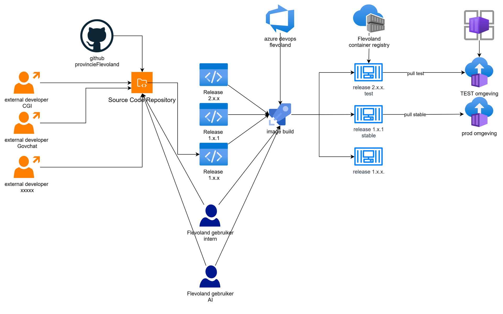

# Schrwzr build automation: design document

| | |
|---|---|
| Status | Draft for review |
| Date | 2026-10-12 |
| Scope | Building container images from the Schrwzr source repository and rolling them out to the TEST Azure Container App; acc and prod (separate subscription and ACR) are described but not built yet |
| Source diagram | [build-automation-diagram.png](build-automation-diagram.png) |
| Pipeline | [.azuredevops/dev/azure-pipelines.yml](../.azuredevops/dev/azure-pipelines.yml) |

---

## 1. Summary

Several development parties (external developers from CGI, GovChat and others, plus internal
Flevoland users) contribute to one source repository on GitHub (`provincieFlevoland`). Code is
organised in release lines (`2.x.x`, `1.x.1`, `1.x.x`). Azure DevOps (organisation `flevoland`)
builds a container image per release line and pushes it to the Flevoland Azure Container
Registry. The TEST environment runs the `test` image (release 2.x.x) and the prod environment
runs the `stable` image (release 1.x.1). Both environments are Azure Container Apps.

This document describes the design as drawn (section 3), analyses it and proposes
improvements (section 4), and works out the technical details: pipeline triggers (section 5),
image tagging (section 6), and rolling a new image out to the Container App (section 7). A
working sample pipeline is in [.azuredevops/dev/azure-pipelines.yml](../.azuredevops/dev/azure-pipelines.yml).

## 2. Assumptions

These were not in the diagram and were filled in from the existing Flair code
(`tf-azure-ai-govchat`, `module-tf-azure-container-app`) or chosen as reasonable defaults.
Please correct any that are wrong.

| # | Assumption | Basis |
|---|---|---|
| A1 | The source repository is the private GitHub repo `ProvincieFlevoland/flairschrwzr`. | `.azuredevops/dev/pipeline-dev-docker-build.yaml` already builds from it. |
| A2 | TEST uses the registry `acrflvaidev01` (`acrflvaidev01-bgbqa0bwfjhra4dv.azurecr.io`, subscription `flv-landingzone-ai-hub-dev`). | `dev-schrwzr.tfvars` and the docker build pipeline. |
| A3 | "TEST omgeving" and "prod omgeving" are Azure Container Apps (the purple icon top right). TEST corresponds to the `dev-schrwzr` stack today. | `dev-schrwzr.tfvars`, diagram icons. |
| A3a | Acc and prod will run in a **separate subscription with their own ACR**. That landing zone does not exist yet; this document only describes how it will connect, and the sample pipeline has no acc/prod stages. | Confirmed by the project owner, 2026-10-12. |
| A3b | **Dev and test (TST) share one environment for now**: `dev-schrwzr`. Users test there when developers ask them to. This is not a permanent choice; the pipeline keeps "deploy to dev/test" as one stage driven by variables, so a separate test environment can be added later as an extra stage without changing branches, tags or versioning. | Project owner, 2026-10-12. |
| A4 | The image in scope is the one built from `flairschrwzr` (today `govchat-adminoverlay`, deployed to `aca-flair-admin-dev-schrwzr`). The design is generic, so it applies to any image built from that repo. | Docker build pipeline. |
| A5 | Pipelines run on the self-hosted pool `devcenter-devops-agents` and authenticate to Azure with an ADO Azure Resource Manager service connection (`sc-iac-ai-hub-dev` today). | Existing pipelines. |
| A6 | The Container Apps pull from ACR with their user-assigned identity (`<app>-secrets-uai`), which the module already grants `AcrPull`. | `module-tf-azure-container-app/main.tf` (`container_app_registry_access_uai`). |
| A7 | Azure DevOps YAML pipelines, not classic release pipelines. | Requested; matches existing pipelines. |

## 3. Current design (as drawn)



### 3.1 Actors

| Actor | Role in the diagram |
|---|---|
| External developer CGI | Pushes code to the source repository. |
| External developer GovChat | Pushes code to the source repository. |
| External developer xxxxx | Placeholder for further external parties; pushes code to the source repository. |
| Flevoland gebruiker intern | Works on the source repository and starts/approves image builds. |
| Flevoland gebruiker AI | Works on the source repository and starts/approves image builds. |

### 3.2 Components

| Component | Description |
|---|---|
| GitHub `provincieFlevoland` | Hosts the source code repository. |
| Source Code Repository | Single repository that all parties contribute to. |
| Release lines | `Release 2.x.x` (next / test), `Release 1.x.1` (current stable), `Release 1.x.x` (older line). |
| Azure DevOps Flevoland | Runs the "image build" pipeline. |
| Image build | Builds one image per release line and pushes it to the registry. |
| Flevoland container registry | Stores the images: `release 2.x.x test`, `release 1.x.1 stable`, `release 1.x.x`. |
| Container Apps Environment | Hosts the Container Apps. Acc/prod will have their own environment in their own subscription. |
| TEST omgeving | Container App that pulls the `test` image. |
| prod omgeving | Container App that pulls the `stable` image. |

### 3.3 Flow

1. External and internal developers commit to the source repository on GitHub.
2. Work is organised into release lines (2.x.x, 1.x.1, 1.x.x).
3. Azure DevOps builds an image from each release line ("image build"). Internal Flevoland
   users can start or approve that build.
4. The image is pushed to the Flevoland container registry and labelled by channel:
   2.x.x as `test`, 1.x.1 as `stable`, and 1.x.x unlabelled (kept for reference/rollback).
5. The TEST environment pulls `test`; the prod environment pulls `stable`.

### 3.4 What exists today

The diagram is partly implemented in `tf-azure-ai-govchat`:

* `pipeline-dev-docker-build.yaml` builds `govchat-adminoverlay` with `az acr build` from
  `ProvincieFlevoland/flairschrwzr` (`main`, folder `admin`) and tags it `latest` and
  `$(Build.BuildId)`. It has `trigger: none`, so it only runs manually.
* Rolling out is a manual second step: re-run `pipeline-dev.yaml` (Terraform), stage 10
  (Container App).
* The tfvars reference the image as `...:latest`.

## 4. Analysis and improvements

Ordered by impact.

### 4.1 Mutable tags (`latest`, `test`, `stable`) do not trigger a rollout

**Problem.** A Container App only creates a new revision when its template changes. Pushing a
new image under an existing tag (`latest`, `test`, `stable`) changes nothing in the template,
so neither Terraform nor Azure will roll it out. Re-running `pipeline-dev.yaml` today produces
no change for `govchat-adminoverlay:latest`; the new image only gets picked up when a replica
happens to restart. It is also impossible to tell from the app which build is running, and a
rollback to "the previous `stable`" is not possible because that tag has moved.

**Improvement.** Deploy by immutable reference: `repo@sha256:<digest>` (best) or a unique tag
such as `2.1.0` or `2.2.0-main.a1b2c3d`. Channel tags (`test`, `stable`) may still be pushed as
human-readable pointers, but nothing should deploy from them. See section 6.

### 4.2 Build once, promote the same image

**Problem.** As drawn, prod's `stable` image is built separately from what was tested. Two
builds of the same commit are not guaranteed to be identical (base image updates, package
versions).

**Improvement.** Build each commit once. Promote the exact digest from TEST to acc and prod. Because acc/prod
get their own registry, promotion is `az acr import` from the TEST registry, which keeps the
digest, instead of a rebuild.

### 4.3 Rollout is manual and separate from the build

**Problem.** Two pipelines must be run by hand in the right order, and the second one is a full
Terraform run of the whole GovChat stack.

**Improvement.** One multi-stage pipeline: Validate, Build, Deploy TEST now, and later
Promote + Deploy acc and Deploy prod, using Azure DevOps Environments for approvals. The internal
Flevoland users in the diagram become the approvers on the acc/prod environments. See sections
5 and 7.

### 4.4 Clear split between Terraform and the pipeline

**Problem.** If the pipeline sets the image and Terraform also owns `image`, the next
Terraform apply silently reverts to whatever is in tfvars.

**Improvement.** Terraform owns the infrastructure and configuration (env vars, secrets,
scaling, ingress, identity). The release pipeline owns the image version and traffic split.
This needs a small change to `module-tf-azure-container-app` (section 7.4).

### 4.5 Branching and contribution model for external parties

**Problem.** The diagram shows external developers pushing directly into the repository and
release lines without stating how code moves between them.

**Improvement.**

* `main` is the integration branch (next release, today 2.x).
* `release/1.x` (and later `release/2.x`) are maintenance branches; fixes are cherry-picked.
* Releases are git tags `vMAJOR.MINOR.PATCH` on `main` or a `release/*` branch.
* External parties work through pull requests (from forks or feature branches). Protect `main`
  and `release/*`: required PR, at least one review from a Flevoland CODEOWNER, required green
  PR validation build, no force-push.
* Define the support window explicitly: N (2.x, test), N-1 (1.x, stable), and when 1.x.x is
  retired. The diagram's `1.x.1` vs `1.x.x` split suggests "current patch" vs "older patch";
  in this model both are just tags on `release/1.x`.

### 4.6 Security

* **GitHub connection.** The `sc-github-provincieflevoland` service connection is PAT-based.
  Replace it with the Azure Pipelines GitHub App connection: no expiring personal token, scoped
  to the repository, and it is required for CI/PR triggers to work reliably.
* **Azure connection.** Use workload identity federation for the Azure Resource Manager
  service connection (no client secret). Give it only `AcrPush` on the registry and
  `Container Apps Contributor` (or a custom role with `Microsoft.App/containerApps/write`) on
  the Container Apps' resource group.
* **Fork PRs.** In the pipeline settings, do not make secrets available to fork builds, and
  require a comment from a team member before building a fork PR. The PR validation stage
  pushes nothing.
* **Image scanning.** Enable Microsoft Defender for Containers on the registry and/or run a
  Trivy scan in the build stage, failing on critical findings. Optionally generate an SBOM.
* **Registry hygiene.** Keep the admin user disabled, authenticate with managed identity only
  (already the case for pulls), and add a retention policy for untagged manifests.
* **Registry network.** If `acrflvaidev01` gets public network access disabled, `az acr build`
  needs an ACR agent pool inside the VNet (or build with Docker on the self-hosted agent).

### 4.7 Patching base images

**Problem.** Images are only rebuilt when code changes, so OS and runtime CVEs in the base
image accumulate.

**Improvement.** A weekly scheduled run rebuilds `main` and the supported `release/*` branches
and deploys to TEST automatically (section 5.3). Promotion to prod still needs approval.

### 4.8 Separate registries per environment (decided)

The diagram shows one registry for TEST and prod. Decision: acc and prod get their own
subscription and ACR. That keeps dev push rights away from what prod pulls and removes prod's
dependency on a dev resource. The acc/prod registry should only ever be written by the release
pipeline via `az acr import` of an approved digest (no builds there, no human push rights).
Nothing is created for this yet.

### 4.9 Traceability

Set `SOFTWARE_VERSION_TAG` (already an env var on the Flair app) and an OCI label
`org.opencontainers.image.revision` from the build, and use a revision suffix that contains the
version (section 7.2). Then the running revision name, the image digest, the git commit and the
ADO run are all linked.

### 4.10 Database migrations during rollout

If the application migrates its database on start, two revisions running side by side
(section 7.3) can conflict. Migrations must be backwards compatible (expand/contract), or prod
must use a stop-then-start rollout (single revision mode) for releases that contain breaking
migrations.

## 5. Pipeline triggers

### 5.1 Where the pipeline YAML lives

Azure DevOps **repository resource triggers do not work for GitHub repositories**; they only
work for Azure Repos Git. So a pipeline defined in the Azure Repos repo `tf-azure-ai-govchat`
can check out `flairschrwzr` but cannot be triggered by pushes to it. That is why
`pipeline-dev-docker-build.yaml` has `trigger: none` today.

**Recommendation:** keep the pipeline YAML in `ProvincieFlevoland/flairschrwzr` itself, at
`.azuredevops/dev/azure-pipelines.yml`, and create the ADO pipeline from that GitHub repository
(via the Azure Pipelines GitHub App, choosing "Existing Azure Pipelines YAML file" and that path).
That gives native CI, PR and tag triggers. Shared templates can still live in Azure Repos and
be referenced with a `resources.repositories` entry of `type: git`.

Alternative if the YAML must stay in Azure Repos: use a scheduled trigger only, or have a GitHub
Action call the ADO "Run pipeline" REST API. Both are worse than the recommendation.

### 5.2 Trigger matrix

| Event | Trigger block | What runs | Image tag |
|---|---|---|---|
| PR into `main` or `release/*` | `pr:` | Validate: build image, scan, no push | none |
| Push/merge to `main` | `trigger.branches` | Build, push, deploy TEST automatically | `<next>-main.<sha7>` |
| Push to `release/*` | `trigger.branches` | Build, push, deploy TEST automatically | `<line>-rc.<sha7>` |
| Tag `v*` (e.g. `v1.4.2`) | `trigger.tags` | Build, push (locked tag), deploy TEST. Later: import to acc/prod ACR and deploy after approval | `1.4.2` |
| Weekly schedule | `schedules:` with `always: true` | Rebuild for base-image patches, deploy TEST | same as the branch row, plus `-r<buildId>` |
| Manual run | parameters | Redeploy or roll back a given version to an environment | existing tag |

Details:

* **Batching.** `batch: true` on CI so several quick merges produce one build.
* **Path filters.** Exclude `docs/**`, `**/*.md`, `.github/**` so documentation changes do not
  build images. If one repo produces several images (for example `admin/`), add a path include
  per image and one pipeline per image, or one pipeline with change detection.
* **Tags vs branches.** A tag push and the branch push that contains the same commit both
  trigger. Once acc/prod stages exist, they must only run for tag runs (stage condition on
  `startsWith(variables['Build.SourceBranch'], 'refs/tags/v')`).
* **Schedules.** `always: true` is needed, otherwise ADO skips the run when no code changed,
  which defeats the purpose of a base-image rebuild.
* **ACR push trigger (optional split).** If build and deploy should be separate pipelines, the
  deploy pipeline can trigger on a registry push with `resources.containers` of `type: ACR` and
  `trigger.tags.include`. The single pipeline in the sample is simpler and keeps the digest in
  one run.

## 6. Image tagging and versioning

| Source | Tag(s) pushed | Deployed by |
|---|---|---|
| Tag `v2.1.0` | `2.1.0`, `2.1`, `2` | digest |
| `main` | `2.2.0-main.a1b2c3d` | digest |
| `release/1.x` | `1.x-rc.a1b2c3d` | digest |
| Scheduled rebuild | the above plus `-r<buildId>` | digest |
| After a successful deploy | channel pointer `test` or `stable` (optional, informational) | never |

Rules:

* Every deploy uses `<registry>/<repo>@sha256:<digest>`, read back from ACR after the build.
* Semver tags (`2.1.0`) are never overwritten. Enforce with ACR tag locking:
  `az acr repository update --name acrflvaidev01 --image schrwzr:2.1.0 --write-enabled false`.
* `latest` is not pushed any more (or only for local convenience, never referenced in
  tfvars).

## 7. Rolling out a new image to the Container App

### 7.1 Options compared

| Option | How | Pros | Cons |
|---|---|---|---|
| A. `az containerapp update` from the pipeline (recommended) | `az containerapp update --image <repo>@<digest> --revision-suffix <ver>` | Fast, only touches the image, supports revisions, labels, traffic split and instant rollback | Terraform must ignore the image and traffic fields (7.4) |
| B. Terraform apply with an image variable | Pipeline passes the digest to Terraform | Single source of truth in state | Needs a full plan/apply of the GovChat stack per release; traffic splitting in Terraform is awkward; slow |
| C. `AzureContainerApps@1` task | ADO task wrapping `az containerapp up` | Little scripting | Less control (revision suffix, labels, waiting for health), can create resources you do not want |
| D. Mutable tag + restart | Push `stable`, restart revision | No pipeline change | Not reproducible, no rollback, no audit (section 4.1) |

**Recommendation: A.** Terraform creates and configures the app; the pipeline sets the image.

### 7.2 TEST: single revision mode

TEST keeps `revision_mode = "Single"`. A deploy:

```bash
az containerapp update \
  --name aca-flair-admin-dev-schrwzr --resource-group <rg> \
  --container-name admin \
  --image acrflvaidev01-bgbqa0bwfjhra4dv.azurecr.io/govchat-adminoverlay@sha256:<digest> \
  --revision-suffix v2-2-0-b1234 \
  --set-env-vars SOFTWARE_VERSION_TAG=2.2.0-main.a1b2c3d
```

Then the pipeline waits until the new revision reports `provisioningState=Provisioned` and
`healthState=Healthy` (`az containerapp revision show`), runs a smoke test against the app
URL, and fails the stage if either fails. In single mode Azure only moves traffic after the
new revision is healthy, so a failed image does not take TEST down.

Revision suffix: lowercase letters, digits and hyphens only (dots in versions become hyphens),
unique per deploy, kept short because the revision name is `<app>--<suffix>`.

### 7.3 Acc and prod (future, not built yet)

Acc and prod live in a separate subscription with their own ACR. When that landing zone exists,
the pipeline gets three extra stages, gated on tag runs:

1. **Promote:** `az acr import --name <acc/prod-acr> --source acrflvaidev01-bgbqa0bwfjhra4dv.azurecr.io/<repo>@<digest> --image <repo>:<version>`.
   The identity running this needs `AcrPull` on the TEST registry and `AcrPush` on the acc/prod
   registry (or use `--username/--password` with a scoped ACR token on the source, if
   cross-tenant). The digest stays the same, so acc/prod run exactly what TEST ran.
2. **Deploy acc** on ADO environment `schrwzr-acc`, the same steps as TEST but against the
   acc/prod registry and its own service connection.
3. **Deploy prod** on ADO environment `schrwzr-prod` with an approval, using the blue/green steps
   below.

Each Container App pulls only from the registry in its own subscription with its own
`<app>-secrets-uai` and `AcrPull`, which the module already supports through `registries`.

#### Prod rollout: multiple revision mode with a controlled traffic shift

Prod uses `revision_mode = "Multiple"` with traffic pinned to named revisions (not "latest
revision"). Then a new revision starts with 0% traffic.

1. **Deploy** the approved digest with `az containerapp update ... --revision-suffix <ver>`.
   The new revision starts but receives no traffic.
2. **Label and verify.** `az containerapp revision label add --label candidate --revision <new>`.
   The revision is reachable at `https://<app>---candidate.<env-domain>`; run smoke tests there.
   (If ingress is internal or behind Front Door, run the test from the self-hosted agent pool
   inside the VNet.)
3. **Shift traffic.** Optionally canary first, then 100%:
   ```bash
   az containerapp ingress traffic set -n <app> -g <rg> --revision-weight <old>=90 <new>=10
   az containerapp ingress traffic set -n <app> -g <rg> --revision-weight <new>=100
   ```
   Between steps, an ADO Environment check (manual approval or Azure Monitor alert check)
   decides whether to continue.
4. **Keep the previous revision active** for a fixed period (for example 7 days) so rollback is
   instant, then deactivate it: `az containerapp revision deactivate`.

**Rollback** is a traffic switch back to the previous revision name
(`--revision-weight <old>=100`), which takes seconds and needs no rebuild. When the prod stage is
added, it should log the previous revision name so a manual rollback run can use it.

See 4.10 for the database migration caveat.

### 7.4 Terraform changes needed

`module-tf-azure-container-app` has no `lifecycle` block today, and its
`lifecycle_ignore_changes` variable is not used (Terraform does not allow variables in
`lifecycle`). Proposed for module `v1.3.0`:

```hcl
variable "image_managed_externally" {
  description = "When true, the container image, revision suffix and traffic weights are owned by a release pipeline and ignored by Terraform after creation."
  type        = bool
  default     = false
}

resource "azurerm_container_app" "this" {
  count = var.image_managed_externally ? 0 : 1
  # ... unchanged ...
}

resource "azurerm_container_app" "external_image" {
  count = var.image_managed_externally ? 1 : 0
  # ... same arguments as "this" ...

  lifecycle {
    ignore_changes = [
      template[0].container[0].image,
      template[0].revision_suffix,
      ingress[0].traffic_weight,
    ]
  }
}

locals {
  container_app = one(concat(azurerm_container_app.this, azurerm_container_app.external_image))
}
```

Plus `moved` blocks from `azurerm_container_app.this` to `azurerm_container_app.this[0]` so
existing apps are not recreated, and outputs switched to `local.container_app`. In tfvars, set
`image_managed_externally = true` on the Schrwzr app only and keep its `image` as the initial
image used at creation. Note that `container[0]` means the first container: the Schrwzr apps
have one container each, so that is enough.

Ingress for prod (later) then uses `traffic_weight { latest_revision = false, revision_suffix = ..., percentage = 100 }`
at creation time; afterwards the pipeline owns traffic.

### 7.5 Authentication summary

| From | To | How |
|---|---|---|
| ADO pipeline | GitHub repo | Azure Pipelines GitHub App service connection |
| ADO pipeline | Azure TEST (ACR build/push, Container App update) | ARM service connection with workload identity federation; roles `AcrPush` + Container Apps write on the app RG |
| ADO pipeline | Azure acc/prod (future) | Separate federated service connection scoped to the acc/prod subscription |
| Container App | ACR in its own subscription (pull) | User-assigned identity `<app>-secrets-uai` with `AcrPull` (already in the module) |
| Acc/prod registry (future) | TEST registry | `az acr import` run by the pipeline identity with `AcrPull` on source and `AcrPush` on target |

## 8. Sample pipeline

[.azuredevops/dev/azure-pipelines.yml](../.azuredevops/dev/azure-pipelines.yml) implements sections 5 to 7:

* **Validate** (PRs): `docker build` without push, Trivy scan.
* **Build** (CI, tags, schedule): computes the version, `az acr build`, reads the digest back,
  locks semver tags, publishes `image.json` as a pipeline artifact.
* **DeployTest**: deployment job on environment `schrwzr-test`, `az containerapp update` by
  digest, waits for a healthy revision, smoke test, moves the `test` pointer tag.
No acc/prod stages yet (section 7.3 describes them for later).

Before first use, fill in the TEST resource group at the top and create the ADO Environment
`schrwzr-test`.

## 9. Open questions

1. Is `ProvincieFlevoland/flairschrwzr` the repo in the diagram, and does it produce one image
   (`admin/`) or more?
2. Is `aca-flair-admin-dev-schrwzr` the "TEST omgeving" app, and which apps will acc and prod
   be once their subscription exists?
3. What exactly distinguishes `1.x.1` from `1.x.x`, and how long is each line supported?
4. Who are the prod approvers (the "Flevoland gebruiker intern / AI" groups)?
5. Does the application run database migrations on start (4.10)?
